# OASIS — Build Plan & Scope v1

2026-09-18 · @Tabor

## Goal

OASIS gives every Cluer Holdings employee a personal AI agent that knows them, knows their job, and works alongside them all day. It is not a chatbot. It is a coworker that lives on their computer, sees how they work, and steadily takes the repetitive parts off their plate.

What each agent does:

- **Knows the person.** Learns their role, their ventures, their tools, their habits and their preferences through onboarding, conversation, and watching them work. Keeps a living profile that the person can read and correct at any time.&#32;
- **Knows the company.** Reads company data across every venture Cluer owns and operates, through one shared pipeline with one drawer per venture. Answers with sources. Respects role gates so each person sees only what their role allows.
- **Watches and proposes.** Sees what the person does on their computer and in their apps, finds the repeat work and the waiting, and proposes faster ways. Nothing runs until the person says yes.
- **Does the work.** Runs tasks on the local machine, in the browser, and in cloud tools: drafts, reports, filing, follow-ups, data pulls, multi-step jobs across several services. Turns anything done once into a button that can be pressed again.
- **Researches.** Pulls together answers from company data, connected tools, and the web, across ventures, in one place.
- **Connects itself.** Sets up its own tools and logins for the person, guiding them step by step through the few clicks only a human can do. No terminals, no keys. One Settings screen exists (avatar and theme first, decision #75), but the defaults work, so nobody has to open it.
- **Learns and improves.** Every skill it builds is tested, versioned and shared. What any agent learns, every agent gets: the newest agent starts with everything, and the oldest agent upgrades itself to match. Agent 1 is always as capable as agent 10.

Under the agents sits the Journals: one shared, secure RAG pipeline that is the company's source of truth. Data is stored under our control, organized by venture, tagged by sensitivity, searchable across ventures for those allowed. It is modular: any model (Claude, OpenAI, xAI, Ollama, OpenRouter, later our own hardware) and any tool (MCP servers, CLI tools, connectors) plugs in through one interface, so we swap parts without rebuilding agents.

End state: a new employee installs one app, spends an hour onboarding with their agent, connects their tools with a few clicks, and from that day has a coworker that knows the company, knows them, and gets more useful every week.

We build the agents first and the pipeline last. Two real users, Amber,  and Michael, teach us what the pipeline needs before we build it.

## Build order

Amber's agent ships first, Michael's second, the shared pipeline third. Each phase ends with a written playbook that the next phase reuses.

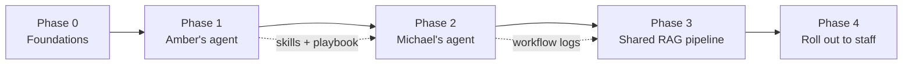

Phase 0 is one to two weeks of groundwork so Phase 1 is not built on sand: repo, model connector, memory store, logging, and the way we save skills. Everything after that is learned from real use.

| Phase | What ships | Done when | Rough length |
| --- | --- | --- | --- |
| 0 Foundations | Scrubber + proxy, loop runner, memory, model switch, skill format, thin Windows app, Gmail/Outlook connect, app registrations | Braden is user zero: installs, connects Gmail, records one macro, runs one skill through the loop | 2 weeks |
| 1 Amber | COO agent: knows her role, watches her workflow, proposes and runs automations | She uses it daily; 3+ manual tasks now automated; playbook written | 4–6 weeks |
| 2 Michael | Owner agent built from the playbook; cross-venture view | Built in half the time of Phase 1; playbook updated | 2–4 weeks |
| 3 Pipeline | Per-venture data stores, ingest, search, role gates, both agents plugged in | Both agents answer from company data, not local files | 6–10 weeks |
| 4 Roll out | Employee UI, agent-per-role template, onboarding | New employee agent set up in under a day | ongoing |

Lengths are guesses. We tighten them after Phase 0.

## Scoreboard — automated measurement that tunes the system

The Scoreboard is its own agent. It reads every log, computes the numbers, spots what is slipping, and proposes or makes the fix. Nobody fills in a spreadsheet. It runs in `agent-core` as a scheduled skill from Phase 0, so every later agent is measured from its first day.

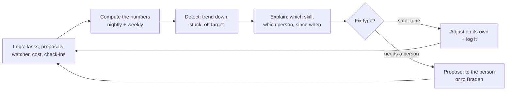

**What it measures.** Every number comes from data the system already has. The only human input is a 30-second weekly check-in in the orb.

| Measure | Source | Computed | Phase 1 target (Amber) |
| --- | --- | --- | --- |
| Hours given back per week | Watcher time on a task before a skill existed vs skill run time after | Nightly | 5+ by week 6 |
| Tasks automated | Skills saved and run 3+ times with no fix | Nightly | 3+ |
| Proposals accepted | Yes / (yes + no) on the daily note, by proposal type | Nightly | 40%+ |
| Skill success rate | Loop runs that passed their checker first try, per skill | Nightly | 90%+ per skill |
| Answers with sources | Data answers that cite a source / all data answers | Nightly | 100% |
| Time to yes | Minutes from proposal shown to answered | Nightly | Falling |
| Ask-first friction | Ask-first prompts per day and share answered yes | Nightly | Yes share rising |
| Cost per task | Model spend / tasks completed, per skill and per model | Nightly | Falling |
| Trust | Weekly 1–5 in the orb: "I trust it to do what I said" | Weekly | 4+ by week 6 |
| Days used | Workdays the orb or app was opened without a reminder | Weekly | 90%+ after week 2 |

**What it does with the numbers.** Three levels of action, by how safe the change is:

| Level | Example finding | What the Scoreboard does |
| --- | --- | --- |
| Tune on its own | Skill X passes 98% on model A and 80% on model B at the same cost | Switches skill X to model A, logs the change, shows it in the weekly report |
| Tune on its own | A proposal type has been told No 3 times | Stops offering it; notes it for the weekly review |
| Tune on its own | Ask-first prompt for step Y answered Yes 20 times in a row | Proposes to the person: "Want me to stop asking for this one?" |
| Propose to the person | Hours in QuickBooks up 40% this month, no skill covers it | Adds a proposal to the daily note with the evidence |
| Propose to Braden | Skill Z success rate fell from 95% to 70% since version 1.3 | Opens a ticket in the skills repo with the failing runs attached; suggests rolling back |
| Propose to Braden | Trust score dropped two weeks running | Flags it in Braden's weekly report with what changed those weeks |
| Alert | Spend crossed a $500 line, or a loop hit its cap 3 times in a day | Message to Braden the same hour |

The Scoreboard never touches skill code or the person's data. It changes config (which model, which schedule, which proposals are on), opens tickets, and writes proposals. A person or the build loop makes any change beyond that.

**Where the numbers show up.** A Scoreboard tab in the app for the person (their own numbers, plain words, no charts they have to read). A Braden view across all agents. A weekly report written by the Scoreboard itself: what moved, why it thinks so, what it changed, what it wants approved.

**Phase gates use it.** A phase is done when the Scoreboard shows the targets met for two weeks running, not when the code ships. Targets for Phase 2 onward are set from Phase 1's actual numbers, by the Scoreboard, and approved by Braden.

**Why this is its own agent and not a dashboard.** A dashboard waits to be read. The Scoreboard reads itself, and the same loop discipline applies: every change it makes is small, logged, checkable and reversible.

## Phase 0 — Foundations

Phase 0 builds the smallest thing Amber can install, plus the parts that are dangerous to get wrong later. Two weeks. User-facing surface is only the orb, a chat panel, a Connect tile that works, and the activity log.

What gets built, by repo:

| Repo | Phase 0 deliverable | Done when |
| --- | --- | --- |
| `remote` (Zemeckis) | Scrubber with a leak test suite; proxy that records on Windows; macro file format v1 | 0 secrets leak across 200 recorded test traces; one real macro recorded and replayed |
| `agent-core` (Anorak) | Loop runner; memory store; model switch (Claude + OpenRouter + Ollama); logging | One skill runs end to end through the loop on two different models |
| `skills` (Almanac) | Skill folder format; test runner; 3 starter skills (daily summary, file filing, meeting prep) | All 3 pass their test cases |
| `connectors` (Gates) | Catalog format; Cluer app registered with Microsoft and Google; Gmail + Outlook connect flow | Braden connects Gmail and Outlook with clicks only |
| `desktop-app` (Rig) | Thin Windows shell: the orb, side panel with chat, Connect page, activity log, pause button; installer; auto-update. "Thin" means no onboarding polish, no Docs area, no Scoreboard tab yet | Installs on a clean Windows machine, orb shows above every window, updates itself |
| `playbooks` (Garage) | This plan, decisions log, agent-template skeleton | Repo exists and project-swarm can read it |

**Memory, defined now so every agent shares it.** Four kinds, all in the person's own drawer, all readable by the person in the app:

1. **Profile** — the role file: who they are, their job, tools, people, preferences. Written at onboarding, edited by them, grown by the agent with their approval.
2. **Working memory** — what the agent is doing right now and what it learned this session. Cleared when the task ends, summarized into the log.
3. **Log** — every task, proposal, yes/no, tool call and cost. Append-only. The weekly review reads it.
4. **Notes** — the person's own docs plus the agent's saved observations ("Amber does payroll Thursdays"). Searchable. The agent may propose a note; the person confirms it.

**Proactive work.** The agent does not only wait to be asked. From Phase 1 it runs scheduled skills: a morning brief (calendar, unread that matters, what it plans to propose today), reminders it was asked for, and the daily proposal note. Each is a skill with a schedule, so the person can turn any one off.

**Formats, fixed in Phase 0.** Three small files everything else depends on:

| File | Holds | Shape |
| --- | --- | --- |
| `profile.yaml` | The role file | `name, title, reports_to, ventures[], tools[], people[], day[], preferences{}, access_level` |
| `SKILL.md` + `skill.yaml` | One skill | `name, goal, done_when, steps[], checker, risky_steps[], schedule?, version, test_cases[]` |
| `connector.yaml` | One connector | `name, provider, auth_type, scopes[], can_do[], roles_allowed[], setup_steps[]` |

Phase 0 ends with Braden as user zero: the Rig on his own Windows machine, Gmail connected, one macro recorded, one skill run through the loop, all logged.

**First 14 tickets plus T03b**, in order (full detail in `TICKETS.md`; the secrets interface comes second because registrations, macros and connectors all need it, and the Scoreboard skill closes the phase). These are what project-swarm picks up on day one. Each is one PR with tests.

| # | Repo | Ticket | Done when |
| --- | --- | --- | --- |
| 1 | playbooks | Create all repos from one template: README, docs/, src/, tests/, CHANGELOG, CI that runs tests | 9 repos exist, CI green on empty tests |
| T03 | connectors | Register the OASIS app with Microsoft (Entra) and Google Cloud; readiness probe | IDs stored + Microsoft passes + Google probe passes |
| T03b | connectors | Public OASIS homepage/privacy page and domain prerequisites; Google verification; Microsoft admin consent | Public pages/domain prerequisites complete; verification submitted with real evidence; admin consent granted. Blocks T11 Gmail connect, not T03 |
| 3 | remote | Scrubber: header, cookie, key, query and high-entropy masking; 200-trace leak test | 0 leaks, fails toward hiding |
| 4 | remote | Local proxy on Windows: install cert, record HTTP, write raw trace to scrubber | Records Edge, Chrome and Outlook traffic on a test box |
| 5 | remote | Macro file v1: constants vs arguments, replay, ask-first flag, rollback | One recorded task replays with one changed argument |
| 6 | agent-core | Loop runner: plan, act, check, fix, budget, gate, log | One skill runs through it with a fake tool and a real check |
| 7 | agent-core | Model switch: Claude, OpenRouter, Ollama behind one interface; config per agent | Same skill runs on two models with no code change |
| 8 | agent-core | Memory: profile, working, log, notes in the person's drawer; secrets interface over OS keychain | Profile survives restart; a secret is stored and read without ever being printed |
| 9 | skills | Skill format, test runner, 3 starter skills | All 3 pass on 3 test cases each |
| 10 | connectors | Catalog format; Gmail and Outlook connect flows with the guided screens | Connect with clicks only, token in keychain, connection tested |
| 11 | desktop-app | Thin Windows shell: sign in, chat, Connect page, activity log, pause; installer; auto-update | Installs clean, updates itself |
| 12 | playbooks | Onboarding script v1: the agent's self-introduction and the question set | Braden runs it as user zero and his profile.yaml reads true |

## Phase 1 — Amber's agent (COO)

Amber's agent starts as a watcher and note-taker, earns trust, then starts doing. Never the other way around.

**Week 1–2: Onboarding, both ways.** Amber installs the Rig and goes through onboarding with her agent (next section). The agent explains what it is and what it will do; she tells it who she is, what she does, and what tools she uses. Braden does not need to know her job in advance; the agent learns it from her and from watching. Amber oversees every venture and gets full data access from day one.

**Week 2–4: Watch and propose.** Install the agent on her machine with read-only tools: watch active windows and files, read her calendar and inbox, log what she does. Each day it writes a short "here is what took you the most time and how I could do it" note. She marks each one yes, no, or later. Nothing runs without a yes.

**Week 4–6: Do the work.** Turn the yes items into skills. Start with the boring, repeatable ones (pulling numbers into a report, chasing a status update, filing documents). Each skill runs once with her watching, then on its own with a log she can check.

Tools the agent gets, in this order:

| Stage | Tools | Risk level |
| --- | --- | --- |
| Watch | Screen/window log, file access log, calendar read, email read | Low — read only |
| Propose | Local notes memory, daily summary writer | Low |
| Do (local) | File edits, spreadsheet fills, document drafts | Medium — changes on disk |
| Do (browser/cloud) | Browser automation, SaaS APIs (email send, task tools) | High — acts as her |
| Research | Search over company files and past notes | Medium — data exposure |

What we capture from Phase 1, because Phase 3 needs it:

- Which data she reaches for and where it lives (this becomes the first venture data drawers).
- Which tasks were worth automating and which were not.
- Every prompt, skill and fix, with a note on why.
- How much she trusted the agent at each stage and what changed her mind.

Done when: she uses it every workday without being reminded, at least three manual tasks are fully automated, and the Amber playbook is written.

How the agent watches her computer: REMOTE (next section) for web work, plus a light window and file log for everything else.

## Onboarding — the agent learns her, she learns the agent

Onboarding is the most important screen in the product. It is a conversation, not a form. In about an hour the agent learns who Amber is and what she does, and Amber learns what the agent is, what it will watch, and what it can do for her. Nothing else in Phase 1 works if this is weak.

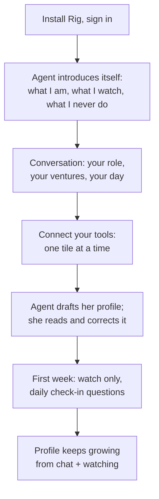

**Part 1: the agent explains itself.** Plain words, short screens, one idea each. What it is (a coworker on your computer). What it watches (your apps and files, to find repeat work). What it never does (act without a yes, share your data outside the company, hide what it did). How to talk to it, how to stop it, how to see everything it has done. She can ask it anything at this point and it answers from the same script.

**Part 2: she tells it about herself.** The agent asks, she answers by talking or typing, as long or short as she likes. Questions cover her title and who she reports to, which ventures she touches and how often, what a normal day and week look like, which tasks she hates or repeats, which tools she lives in, who she works with most, and how she likes to be spoken to. The agent asks follow-ups the way a new hire would. Skipped questions come back later in daily check-ins.

**Part 3: her profile.** From the conversation the agent writes her role file in plain English: My role, My ventures, My day, My tools, My people, My preferences. She reads it in the app and edits any line. This file is the agent's memory of her and she owns it. It grows from every chat and every watched task; she can open it any time to see what the agent thinks it knows.

**Part 4: her own docs.** A Docs area in the app where she writes anything she wants the agent to know: how a process works, a checklist she keeps in her head, notes about a venture. Plain text or talk-to-type. Everything she writes goes into her personal drawer and is searchable by her agent right away.

**Part 5: connect tools.** The Connect tiles from the connections section, walked through one at a time, starting with the tools she named in Part 2.

**Ongoing.** A short daily check-in for the first two weeks ("I saw you spend 40 minutes in QuickBooks this morning. Is that a weekly thing?"). After that, only when the agent has a real proposal or a real gap in what it knows.

Done when: Amber finishes onboarding without help, her profile reads true to her, and she can explain to Michael in her own words what the agent does and does not do.

The same flow, with a different role file, is Michael's onboarding in Phase 2 and every employee's in Phase 4. The Phase 1 open questions about Amber's ventures, apps and tools are answered by onboarding, not by us guessing.

## REMOTE — the watcher that turns work into buttons

REMOTE is the watch-and-learn engine inside every employee's agent. The employee does a task once; REMOTE records it, strips the secrets, and turns it into a button they can press again. Design: [REMOTE concept](https://claude.ai/artifact/6NCF3KsF5XCNP4QsERa2FW?sk=5ADPTHRDIYcAmuGX5IvXRw).

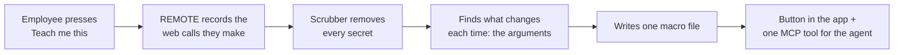

**How it works.** A small local proxy on the employee's machine records the web requests their apps make while a task is being taught. Secrets (logins, keys, cookies) are masked before anything is saved; if a value cannot be proven safe it is hidden. Constants and arguments (the ticket number, the client name) survive. The result is one plain-text macro file per task, and the agent sees it as one tool, not forty.

**What we change for non-technical employees.** REMOTE as designed is a command-line tool. Ours hides all of that behind the desktop app:

| REMOTE as designed | In our app |
| --- | --- |
| `remote learn "task"` in a terminal | A **Teach me this** button; the app names the task from what it sees |
| `remote stop` | A **Done** button, or the agent notices the task ended |
| Web editor to reorder steps, mark "ask me first", add rollback | Same editor, inside the app, with plain labels; agent suggests the "ask me first" steps |
| `remote auth add <service>` | The Connect tile from the connections section |
| Macro files in a folder | Same files, kept in the person's private drawer (never git: they hold client names and task data). Versioned locally. A macro becomes shareable only after it is turned into a skill with company data replaced by arguments and test fixtures using fakes |

**How it feeds the agent.** Each macro becomes a personal skill (see Skills). The agent's daily "here is what took you the most time" note can now end with "press Teach me this next time you do it and I'll make it a button." When the same button shows up for two people, it gets promoted to a shared skill.

**What REMOTE alone misses.** It only sees web traffic. Work that never leaves the machine (offline Excel, moving files, reading a PDF) needs a second, lighter signal: active window and file-open logging. Both feed the same daily note. The proxy also cannot see inside apps that pin their own certificates; those go through their connector instead.

**Security fit.** Runs local, no cloud, tokens in the OS keychain. This matches the Security section. One addition: macros that act as the employee (send email, pay, sign) default to "ask me first" until the person turns that off per button.

This settles the Phase 1 open question: REMOTE is the daemon. Phase 0 builds the scrubber first and tests it hardest, as the design says.

**What it watches: everything, with permission asked once.** These are company machines, so the agent has full access by default. Full access means no role or permission barrier stands between the agent and any site or app on the machine. Watching a given site or app still begins only after the person answers once. The first time the person lands on a new site or app, the orb asks one plain question: "Can I watch this page?" Yes (this site from now on), No (never this site), or Not now (ask again next visit). Yes and No are saved per site or app and never asked again; the person can change any answer in the app. Everything the watcher saved is visible in the activity log, and the pause button stops all watching until it is pressed again. The agent explains exactly this in onboarding.

## Phase 2 — Michael's agent (owner)

Michael's agent is the same build as Amber's with a different role file and a wider view. If it takes more than half of Phase 1's time, the playbook is not good enough yet and we fix the playbook, not just the agent.

What carries over untouched: the agent shell, memory store, model switch, watch/propose/do stages, and every generic skill (summaries, file filing, report pulls).

What changes:

- **Role file.** Owner, not operator. Fewer repeat tasks, more decisions. The agent leans toward briefings and cross-venture questions ("how did every venture do this month?") over task automation.
- **Data reach.** Michael sees everything. His agent is the first one that has to search across more than one venture, so this phase forces us to draft the per-venture data layout before Phase 3 builds it.
- **Trust.** He will have less patience for the watch stage. Shorten it, but keep the yes/no gate on anything that acts as him.

Done when: Michael uses it weekly or more, it can answer at least one real cross-venture question from company data, and the playbook is updated to a "new agent in one day" checklist.

## Phase 3 — The shared RAG pipeline

One pipeline, five layers. Each layer has a plain interface so we can swap what sits behind it.

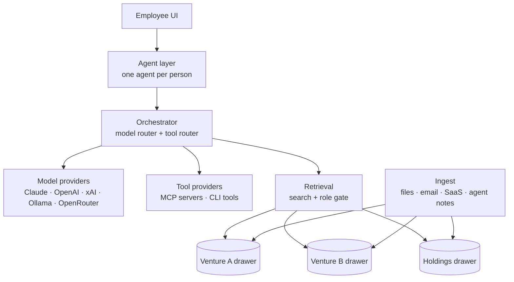

**Data layout: one drawer per venture.** Each venture gets its own store (documents, embeddings, metadata) with the same folder shape. A Holdings drawer holds what is shared across ventures. Every document carries: venture, source, owner, date, sensitivity level. Agents search one drawer or many; the role gate decides which.

First drawers, one per venture, plus Holdings:

| Drawer | Venture | What it is | Note |
| --- | --- | --- | --- |
| holdings | Cluer Holdings | Parent company; shared docs, finance, HR | Everyone's agent can see what their role allows |
| rdw | RDW, LLC | Owns all retail locations as DBAs | One drawer, a folder per location |
| bin-there | Bin-There Bought That | Retail | In Emily's name; Amber has full access |
| alpena-trucking | Alpena Trucking | Trucking |  |
| wk-trucking | Wayne Kelley Trucking | Trucking |  |
| jmac | JMAC Construction | Construction | No revenue yet; small drawer |
| gold-run | Gold Run LLC | Shell company | Legal and filings only |
| glory-road | Glory Road | Boat charter, Louisiana |  |
| evage | Evage LLC | Recycling |  |

Adding a venture later is adding a row here and running the new-drawer script.

**Model layer.** One interface: send messages, get a reply, stream, call tools. Behind it, one adapter per provider. Start with Claude and OpenRouter (OpenRouter alone covers most of the rest for testing). Add Ollama early so the local-hardware path is proven before we buy hardware. Model choice lives in config, per agent and per task, never in code.

**Tool layer.** Every tool the agent can use is an MCP server or a wrapped CLI command, registered in one catalog with a name, what it does, and which roles may use it. Agents get a tool list from the catalog at start, not a hard-coded set.

**Retrieval.** Hybrid search (keyword plus embeddings) with reranking. Return chunks with their source so every answer can show where it came from. Log every query and which chunks came back; this is how we tune it.

**Ingest.** Connectors that watch a source (a shared drive, email, a SaaS export, an agent's own notes), chunk it, tag it, and drop it in the right drawer. Re-ingest on change. Start with whatever Amber and Michael reached for most in Phases 1 and 2.

**UI.** One clean chat screen per employee: talk to your agent, see what it did today, approve or reject proposals, see which sources an answer used. Admin view for adding drawers, connectors, tools and roles.

Storage and hosting: Azure, because the team already lives in Microsoft 365. One VM we control running containers, Azure Postgres with pgvector for the drawers, Blob storage for files, Entra ID for employee sign-in. Everything in Docker so it is portable; nothing tied to Azure-only services. Encrypt at rest, backups nightly, no company data sent to a model provider that trains on it. Moving to our own hardware later is then a move, not a rebuild.

Done when: Amber's and Michael's agents run on the pipeline instead of local files, every answer shows its sources, and a new venture drawer can be added in a day.

## The Rig — install, hands, and the orb

The agent is installed once, touches the computer through four hands, and stays visible as a small orb above every window. Employees never have to open a settings screen; the one Settings screen is optional (decision #75).

**Install.** One signed installer (`.exe` on Windows, `.dmg` on Mac). Double-click, sign in with the company Microsoft account, done. It installs two things: a background service that starts with the computer (the agent, the watcher, the proxy) and the visible app. Updates download and apply silently. Uninstall is one button and removes everything, including local memory.

**Five hands, used in this order:**

| Hand | What it does | When |
| --- | --- | --- |
| Connectors (Gates) | Talks to Gmail, QuickBooks, Teams and the rest directly | First choice: fastest, safest, no screen needed |
| Browser extension | Sees and acts in the tab the person is in | Web apps with no connector; also the fallback when the proxy cannot see traffic |
| Screen control (Windows UI Automation, Mac Accessibility) | Reads what is on screen, clicks, types, opens apps | Local apps: Excel, File Explorer, anything without an API |
| Agent's own browser | A hidden Playwright-driven browser with its own profile and the person's connector logins | Background web work, in parallel with the person |
| Files and shell | Reads, writes, moves files; runs scripts | Under the hood, never shown to the person |

Every hand goes through the same loop and the same ask-first gate. Screen control and shell are the most powerful and the most dangerous, so their risky steps default to ask-first for longer. Nobody, including the person, can turn off ask-first on a risky step until that skill has passed the injection test suite. After that, the Scoreboard may propose relaxing one step at a time and the person accepts or not. Steps tagged `always_ask` in the skill (pay, sign, delete, send money) never relax.

**The orb.** A small round button pinned above every window, like a chat head. Drag it anywhere. It is the agent's face and it is always there.

- Click: a side panel slides out with chat, today's proposals, and chips based on what is on screen right now ("You're in QuickBooks. Want me to pull this week's invoices?").
- Hotkey (Ctrl+Space, changeable): opens the panel from anywhere, even full-screen apps.
- Status: eight states in the API, three looks on screen, so nobody has to learn eight colors (decision #74).

  | Look | States | On screen |
  | --- | --- | --- |
  | Calm | idle, done, offline | Dim. Offline also shows a small dark dot. |
  | Active | working, proposal ready | Working: soft pulse. Proposal ready: single glow. |
  | Needs you | asking, needs attention, paused | Asking and needs attention: bright glow with a slow blink. Paused: grey, still. |
- Right-click: pause watching, hide for an hour, open the full app.
- New site or app: the orb asks once, "Can I watch this page?" Yes, No, or Not now. Yes and No are saved, never asked again.

**Avatars and themes.** The orb's character is an avatar pack and the workspace look is a theme pack, both chosen by the person (decisions #75-#77). One animation engine runs any avatar pack: every pack uses the same fixed sprite grid (128x128 frames, one row per status state, 4 frames per row, 6 fps) and names its status-light anchor, where the engine draws the three looks above. A theme is a token file (colors, type, radius, motion, sounds) with light and dark variants, read at runtime. `avatar:` and `theme:` in profile.yaml pick them; the person first picks in Get started and can switch any time in Settings, live, with no restart. All art is original: mood-inspired, never a recognizable character, name or logo from any film, book or game.

**The full app** is for the slower things: onboarding, Connect tiles, activity log, profile, docs, buttons, Settings. Most days the person only uses the orb.

**Tech.** Tauri for the app (one codebase for Windows and Mac, small install, fast). A browser extension for Edge and Chrome. The service in the same language as agent-core so the loop runner is shared, not copied.

Rule that keeps this from being annoying: default quiet, earn the right to glow. A proposal that gets a No three times stops being offered. If the orb interrupts more than the person wants, they will hide it, and a hidden agent learns nothing.

**Rig visual direction (decision 37).** Use Braden’s supplied floating desktop character as the reference for the orb: a small OASIS character, subtle idle animation, compact controls, and click-to-open chat. Keep T12’s pause, hide, hotkey and activity behaviors. This is the style direction for T12; voice needs separate scope. The local reference is saved at `coordination/references/rig-floating-character.png`.

## Many hands at once — the agent's own browser, screen rules, and parallel tasks

An agent runs several tasks at the same time. Two things make that possible: it has its own browser, and it knows which parts of the computer it must share with the person.

**Two browsers.** The extension rides in the person's real browser (Edge or Chrome) to watch and to help in the tab they are in. Separately, the Python service runs the agent's own hidden browser (Playwright-driven Chromium) for background work: filling a form, pulling a report, checking a portal. It signs in with the same connectors and vault keys, in its own profile, so it never touches the person's tabs or logins. Rule: background web work goes to the agent's browser; the extension acts in the person's browser only when they are looking at that tab and asked for help there.

**Screen: one mouse.** The service can screenshot and read any window at any time (UI Automation on Windows, Accessibility on Mac). Moving the mouse and typing is the one thing that cannot run in parallel with the person. Screen control runs only when (a) the person hands off ("go ahead"), (b) the machine has been idle for a set time, or (c) the task is inside a window the person is not using and the OS allows it without stealing focus. Otherwise the task waits or takes another route: connector first, agent browser second, screen last.

**Scheduler.** The loop runner runs tasks as independent workers, N at a time (default 4, tuned by the Scoreboard). Every task declares the resources it needs before it starts.

| Resource | Sharing | Example |
| --- | --- | --- |
| Connector call (Gmail, Square, ...) | Shared, with per-service rate limits | Two skills reading mail at once |
| Agent browser tab | Shared, one tab per task | Report pull and portal check together |
| Model calls | Shared, within the spend budget | Any |
| A specific file | Exclusive while a task edits it | Two skills cannot write the same spreadsheet |
| Person's screen, mouse, keyboard | Exclusive, and only under the screen rules above | Filing in a desktop app |
| Person's attention (an ask-first) | One at a time, queued, never stacked | Two yes/no prompts never appear together |

Priority: the person's direct request first, then anything blocked on a resource that just freed, then scheduled skills, then proactive proposals. A long background task never delays an answer to the person.

Every worker is still the same loop: plan, act, check, fix, budget, gate, log. The scheduler adds one line to each log turn: which worker, which resources held. The Scoreboard reads that to tune N and to spot tasks that wait too long.

Failure rule: if one worker crashes or hits its cap, the others keep running. The person sees one line in the activity log, not a frozen orb.

## One-click connections and the desktop app

Employees are not technical. They will never see a terminal, an API key, or the word MCP. They click **Connect** on a tool, and the agent does the rest. When a login step needs a human (Google, QuickBooks, payroll), the UI walks them through it one screen at a time.

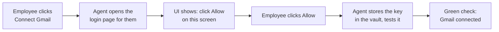

**What the employee sees.** A Connections page with big tiles: Gmail, Outlook, Calendar, QuickBooks, CRM, Payroll, Drive. Each tile is Connect, Connected, or Needs attention. One click starts it. Nothing else to type.

**What happens behind the tile.** We pre-register Cluer as the app with each service once, at the company level. Every employee then reuses that registration, so they only ever do the "click Allow" part. The agent stores the resulting key in the vault under that employee's name, tests the connection, refreshes or rotates keys on its own, and tells the employee only when a human step is needed again.

**Hand-holding rules.** Every human step gets: one instruction, one screenshot or highlight of the button, one Done button. The agent watches for the step to finish and moves on by itself. If it fails, plain words ("QuickBooks said no. Try again or ask Braden."), never an error code.

**Desktop app, not a website.** The agent ships as an app the employee installs once. Windows first (Amber), Mac in the same codebase from day one so it is a build target, not a rewrite. It runs on their computer so it can open files, run local tasks, watch their workflow, and drive their browser. Install is one download and one login. The app auto-updates. The IT side (permissions, background service, updates) is set up by the installer, not the employee.

**Connector catalog.** Each tool we support is a connector: the pre-registered app, the connect steps, what the agent can do with it, and which roles may connect it. Adding a tool for all employees is adding one connector. Tier 1 below is what the team uses today; Tier 2 and 3 are the common set most companies need. Build Tier 1 first, the rest as someone asks.

| Tier | Area | Connectors | Login type |
| --- | --- | --- | --- |
| 1 — in use now | Email | Gmail, Outlook | Click Allow (OAuth) |
| 1 | Calendar | Outlook Calendar, Google Calendar | Click Allow |
| 1 | Files & docs | OneDrive, SharePoint, Word, Excel; Google Drive, Docs, Sheets | Click Allow |
| 1 | Chat | Microsoft Teams | Click Allow (admin approves once) |
| 1 | Chat (informal) | Facebook Messenger, GroupMe | Limited: read via the person's own login; agent drafts, person sends |
| 1 | Payments | Square | Admin key |
| 1 | Payroll & HR | Gusto | Click Allow |
| 1 | Accounting | QuickBooks Online (history; company is switching, new system TBD) | Click Allow |
| 1 | CRM | Cluer CRM (custom — we build the connector) | Our own login |
| 2 — common next | Chat | Slack, Google Chat | Click Allow |
| 2 | Payroll & HR | ADP, Paychex, Rippling | Click Allow or admin key |
| 2 | Payments & banking | Stripe, PayPal, bank feeds via Plaid | Admin key |
| 2 | E-signature | DocuSign, Dropbox Sign | Click Allow |
| 2 | Tasks & notes | Asana, Trello, Monday, Notion, ClickUp | Click Allow |
| 2 | Video | Zoom, Google Meet, Teams meetings (recordings, transcripts) | Click Allow |
| 3 — as needed | Sales CRM | HubSpot, Salesforce, Zoho | Click Allow |
| 3 | Storage | Dropbox, Box | Click Allow |
| 3 | Forms & scheduling | Typeform, Google Forms, Calendly | Click Allow |
| 3 | Marketing | Mailchimp, Constant Contact | Admin key |
| 3 | E-commerce | Shopify, WooCommerce | Admin key |
| 3 | Support | Zendesk, Freshdesk, Intercom | Click Allow |
| 3 | Dev & IT | GitHub, Jira, Google Workspace admin, Microsoft 365 admin | Click Allow |

"Click Allow" means the employee only presses Allow on a screen we open for them. "Admin key" means one person at the company sets it up once and every agent shares it through the vault; employees see nothing. Microsoft tools need one admin approval for the whole company before any employee can connect.

Done when: a new employee installs the app, connects email and calendar in under five minutes with no help, and the agent handles every key and refresh from then on.

## Skills — build, test, save, upgrade, reuse

A skill is a folder: a SKILL.md that says when to use it and how, plus any scripts it needs. Same format everywhere, so a skill built for Amber drops into Michael's agent unchanged.

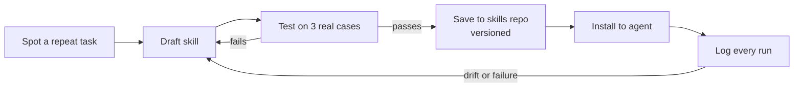

Rules:

1. **One job per skill.** "Pull weekly numbers into the ops report" is a skill. "Help with reports" is not.
2. **Test before save.** Three real past cases, run by the agent, checked by the person. A skill with no test cases does not get saved.
3. **Version everything.** Skills live in git under `skills/<name>/`, with a changelog line per version. The agent logs which version ran.
4. **Two tiers.** Shared skills (anyone's agent can use) and personal skills (one person's quirks). Personal skills that two people want get promoted to shared.
5. **Upgrade by log.** Each skill run writes a short result log. A weekly review reads failures and drift and opens a fix. No silent edits.
6. **Install is config.** An agent's skill list is a file, not code. Adding a skill to an agent is one line.

**Fleet upgrades: every agent improves itself, not just the next one.** Skills, the loop runner and the connectors are shared and versioned, so an improvement made for one agent is an upgrade available to all of them. Think of it as an app store where every agent checks for updates nightly and installs the ones that pass its own tests.

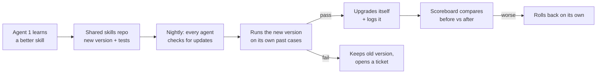

How it works:

1. **One source, many installs.** Every agent pins versions of `agent-core`, `skills` and `connectors`. A pin is a number, not a copy, so moving to the new version is changing the number.
2. **Nightly update check.** Each agent asks the repos what is newer than what it runs. Shared skills, core, connectors. Personal skills are not pushed to anyone else.
3. **Test before switch.** The agent runs the new version against its own last 3 real cases for that skill. Pass: it switches and logs it. Fail: it keeps the old version and opens a ticket with the failing case attached. The person never sees a broken upgrade.
4. **Scoreboard watches the after.** If a skill's success rate or cost per task gets worse in the week after an upgrade, the Scoreboard rolls that agent back and flags the version.
5. **Personal to shared.** When a personal skill works well for one person, the Scoreboard proposes promoting it. Once shared, every agent whose role matches is offered it, and their nightly check installs it after the same test.
6. **Core upgrades roll out in stages.** New `agent-core` goes to Braden's agent first, then one more, then all. A failure at any stage stops the rollout. Amber never gets a core version that has not run on someone else for a day.
7. **Profile and memory never auto-change.** Upgrades touch how the agent works, never what it knows about the person. Their profile, notes and log stay exactly theirs.

What the person sees: a line in their weekly report, "Your agent upgraded 3 skills this week; here is what got faster." Nothing to click. Anyone can hold an agent on a version if there is a reason, but that is the exception and it shows on the Scoreboard as drift.

To settle before Phase 1 ends: who approves a personal skill going shared.

## Agent loops — how all autonomous work runs

Every piece of autonomous work in OASIS, whether an agent doing a task for Amber or project-swarm building a repo, runs inside the same engineered loop. The model does the thinking; the loop does the discipline. A loop is a small program around the model that decides what happens next, checks the result with something other than the model, and knows when to stop.

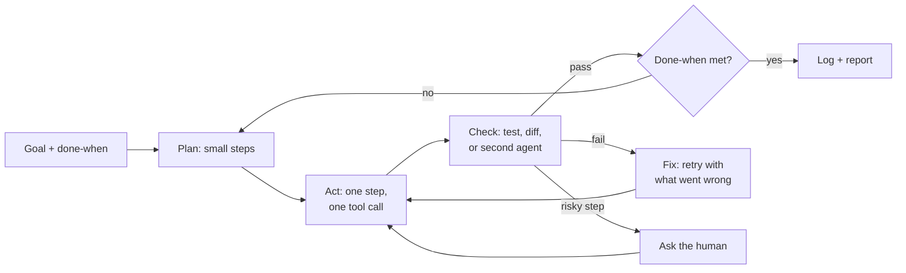

The seven rules every loop follows:

1. **Start with done-when.** No loop starts without a written finish line it can check. "Report filled and totals match QuickBooks" is a finish line. "Help with the report" is not.
2. **Plan small, act once.** Break the goal into steps that each take one tool call or one edit. The model plans; the loop runs one step at a time and looks at the result before the next.
3. **Check with something that is not the model.** A test that runs, a diff that is read, a number compared to the source, a screenshot compared to the expected screen, or a second agent with a different prompt whose only job is to find what is wrong. The model grading its own work does not count.
4. **Fix from the failure, not from scratch.** On a failed check, the loop feeds back exactly what failed and lets the model try again. Three failures on the same step stops the loop and asks a human.
5. **Budget everything.** Every loop has a cap on steps, time and spend. Hitting a cap is a stop with a report, not a crash.
6. **Gate the risky steps.** Sending, paying, deleting, signing, posting as the person: the loop pauses and asks. Which steps are risky is written in the skill, not decided by the model in the moment.
7. **Log every turn.** What was planned, what was done, what the check said, what it cost. The log is what the weekly review reads and what the next loop learns from.

Three loops in this build, same shape, different scale:

| Loop | Who runs it | Goal comes from | Checker | Human gate |
| --- | --- | --- | --- | --- |
| **Task loop** | An employee's agent, many times a day | A request from the person or a scheduled skill | The skill's own test (numbers match, file exists, email drafted not sent) | Risky steps listed in the skill |
| **Learn loop** | An employee's agent, daily | Watch → propose → yes → build skill → test on 3 past cases | The person marks the 3 test runs right or wrong | Every new skill before it is saved |
| **Build loop** | project-swarm, per ticket | A ticket cut from this doc's done-when list | Tests pass, a reviewer agent reads the diff, Braden reviews the PR | Merge |

What this means for the code: `agent-core` (Anorak) ships the loop runner once. A skill is a goal, a step plan, a checker and a risk list dropped into that runner. Nobody writes a new loop per task; they write a new skill. project-swarm should be held to the same shape when we review it in Phase 0.

One more loop over all of them: the **weekly review**. Read the logs, find the loops that failed or stalled, fix the skill or the checker, not the prompt alone. This is how the system gets better instead of just busier.

## Security — data, roles, secrets

Role gates and the secrets vault come later, but three things have to be true from day one or they cost a rebuild.

**From day one (Phase 0):**

- Every stored document carries a sensitivity tag (public, internal, restricted, owner-only) and a venture tag. Empty tags are a bug.
- Every agent action that touches data or acts as a person is logged: who, what, which data, which model, when.
- Company data goes to model providers only under no-training terms (API tiers, not consumer apps). Local models via Ollama for anything tagged restricted or higher.
- Secrets never live in prompts, skill files or git. Phase 0 builds one `secrets` interface with the OS keychain behind it (ticket 2, before anything that needs a key); Phase 3 puts the shared vault (Keys) behind that same interface, so nothing above it changes.

**Later (Phase 3 and 4):**

- **Role gate.** Each employee has a role; each role has a list of drawers and sensitivity levels it can read and tools it can use. The retrieval layer filters by role before search, not after, so restricted chunks never reach the model.
- **Shared secrets vault.** One vault (a password manager with an API, or a self-hosted secrets store) holding all API keys and logins. Each agent has its own identity and pulls only the secrets its role allows, on its own, with no human in the loop. Every pull is logged. Think of it as a keyring where each agent can lift only the keys with its name on them.
- **Kill switch.** One command stops all agents and revokes their vault access.

Risk to name plainly: an agent that can act as Amber in her browser and email can also be tricked by a bad web page or email into acting badly. Every "do" tool stays behind a yes/no gate until we have tested it against that.

## Network data model — what the Stacks will draw

One graph of everything in OASIS: nodes, links, and who may see each. Every loop turn already writes a log line; from Phase 0 that same line also updates this graph. The Scoreboard reads it for numbers; the Stacks will read it for the picture. No second data collection, ever.

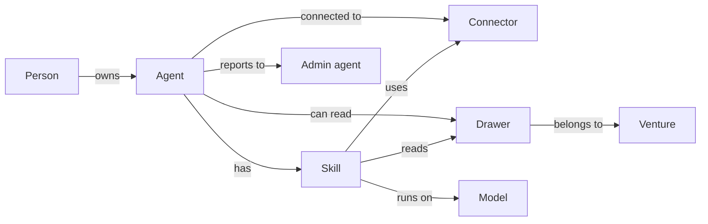

**Node types.** Eight kinds. Every node has `id, type, name, codename?, owner (person id), created_at, status (active, paused, retired), sensitivity (public, internal, restricted, owner-only)`, plus its own fields:

| Type | Own fields | Example |
| --- | --- | --- |
| Person | role, access\_level (member, admin), ventures\[\] | Amber, admin |
| Agent | person\_id, version, profile\_ref | Art3mis |
| Skill | version, tier (shared, personal), success\_rate, last\_run, schedule? | weekly-numbers-pull v1.3 |
| Connector | provider, auth\_type, scopes\[\], health (ok, needs attention, off) | Gmail |
| Drawer | venture\_id, doc\_count, last\_ingest | rdw |
| Venture | legal\_name, kind | RDW, LLC |
| Model | provider, name, cost\_per\_1k, local (yes/no) | claude-sonnet via OpenRouter |
| Macro | skill\_id, argument\_count, ask\_first\_steps | ship-weekly-report |

**Link types.** Every link has `from, to, type, created_at, last_used, use_count, weight (uses in last 30 days)`. Weight is what makes a line glow.

| Link | From → To | Meaning |
| --- | --- | --- |
| owns | Person → Agent | This is my agent |
| has | Agent → Skill | Installed skill |
| connected\_to | Agent → Connector | Live connection, this person's token |
| can\_read | Agent → Drawer | Role gate says yes |
| uses | Skill → Connector | The skill calls this tool |
| reads | Skill → Drawer | The skill searched here |
| runs\_on | Skill → Model | Current model for this skill |
| belongs\_to | Drawer → Venture | Which venture's data |
| built\_from | Macro → Skill | This button became this skill |
| admin\_of | Agent → Agent | Admin agent may see this agent's subgraph |

**Events.** The graph is built from an append-only event stream, not edited by hand: `node_created, node_updated, node_retired, link_created, link_used, link_removed`. Each event carries `actor (which agent or person), at, why (the log line id)`. Replaying the events rebuilds the graph; the Stacks can scrub back in time for free.

**Visibility rule, one sentence.** A person sees a node only if the role gate would let them read the data behind it (venture and sensitivity checked), and, for members, only if they own it or their agent has a link to it; admins pass the gate for everything. A link is visible only when both ends are. The role gate is the one rule; ownership and links only narrow it further for members, never widen it.

| Who | Sees |
| --- | --- |
| Member (default) | Their person, their agent, its skills, its connectors, the drawers it can read, the models it runs on |
| Admin (Michael, Amber, anyone Braden grants) | Every node and link in the company |
| Braden (owner) | Everything plus retired nodes and the event history |

**Where it lives.** Two Postgres tables in the Journals (`nodes`, `links`) plus the `events` table, with the venture and sensitivity columns the role gate filters on. Phase 0 writes events to a local file per agent; Phase 3 ships them to Postgres. The Stacks, when built, reads a filtered graph through one endpoint: `GET /graph?as=<person>`, and the filter is applied on the server, never in the UI.

Done when (Phase 3): every agent, skill, connector, drawer and model in use appears in the graph with correct links, and a member's `GET /graph` returns nothing they could not already read.

## Repos and how project-swarm plugs in

One private GitHub repo per piece. Each is built and tested on its own, so a broken REMOTE build can never touch Amber's agent. Names are placeholders until we pick the product name (not Cluer).

Names come from Ready Player One. Proposed codenames, open to swaps:

| Piece | Codename | Why |
| --- | --- | --- |
| The whole product employees use | **OASIS** | The one world everyone plugs into |
| `desktop-app` | **Rig** | The gear on your desk that gets you in |
| `agent-core` | **Anorak** | The guide inside every agent |
| `remote` (watcher) | **Zemeckis** | The cube that records and replays |
| `skills` | **Almanac** | Anorak's book of how things are done |
| `connectors` | **Gates** | Each one you pass opens a tool |
| Secrets vault | **Keys** | Copper, jade, crystal: what opens the gates |
| `rag-pipeline` | **Journals** | Halliday's Journals: the archive of everything |
| Retrieval inside Journals | **Curator** | The librarian who finds it for you |
| Automated measurement | **Scoreboard** | The leaderboard everyone watches |
| `agent-amber` | **Art3mis** |  |
| `agent-michael` | **Parzival** |  |
| `playbooks` | **Garage** | Aech's garage, where things get built |

Project-swarm keeps its name; it is the build crew (the Gunters), not part of the product.

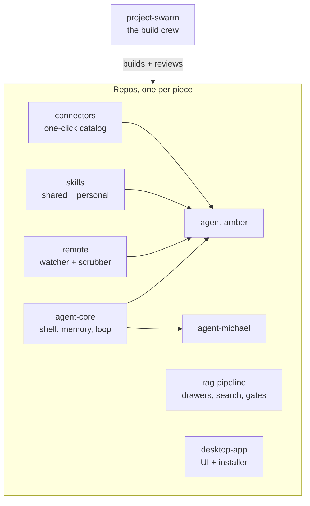

| Repo | Holds | Depends on | Starts in |
| --- | --- | --- | --- |
| `remote` | Local proxy, scrubber, macro format, editor, MCP server | nothing | Phase 0 |
| `agent-core` | Agent shell, memory store, watch/propose/do loop, model switch | nothing | Phase 0 |
| `skills` | Shared skills, personal skills by person, test cases, changelog | nothing | Phase 0 |
| `connectors` | Connector catalog, company app registrations, connect flows | vault | Phase 1 |
| `agent-amber` | Amber's role file, config, skill list, personal macros | agent-core, remote, skills, connectors | Phase 1 |
| `agent-michael` | Same shape as agent-amber | same | Phase 2 |
| `rag-pipeline` | Drawer schema, ingest, retrieval, role gate, model and tool routers | agent-core | Phase 3 |
| `desktop-app` | Employee UI, Connect tiles, Teach-me-this, installer, auto-update | agent-core, remote, connectors | Phase 0 (thin), Phase 4 (full) |
| `playbooks` | Amber playbook, Michael playbook, new-agent checklist, this plan, decisions log | nothing | Phase 1 |

Rules that keep many repos from becoming a mess:

1. **Versioned releases, not branches.** An agent repo pins a version of `agent-core`, `remote` and `skills`. Upgrading is a one-line change and a test run, never a surprise.
2. **Same layout in every repo.** `README`, `docs/`, `src/`, `tests/`, `CHANGELOG`. Anyone (or any agent) opening a repo knows where things are.
3. **One template for person repos.** `agent-amber` is made from an `agent-template`; `agent-michael` is the template plus a different role file. The template is the playbook in code form.
4. **Private by default.** Every repo private under \`Btabor11\` for now, moved to the company org with the team once built and working. No company data in any repo, ever; data lives in the drawers.
5. **Tests gate merges.** REMOTE's scrubber especially: no merge without the secret-leak tests passing.

How project-swarm plugs in: at the start of each phase we hand it that phase's section of this doc as the brief. It opens the repo, breaks the work into tickets, scaffolds from the template, and reviews pull requests against the done-when list. What it learns about building agents goes back into project-swarm as a skill, so the crew gets better each phase.

Before Phase 0 starts, one pass over project-swarm to confirm it can: read a brief from a doc, work across several repos, pin versions between them, and save skills in the format above.

## Risks and what we do about them

Ten things most likely to sink this, ranked by how bad and how likely. Each has an owner action, not a hope.

| # | Risk | Why it matters | What we do |
| --- | --- | --- | --- |
| 1 | Scrubber leaks a secret into a macro file | One leak into git and every key must be rotated | Scrubber built first, 200-trace leak test gates every merge, macros never leave the machine unscrubbed, fail toward hiding |
| 2 | Agent tricked by a web page or email into acting badly (prompt injection) | It acts as Amber in her email and browser | All "do" tools behind ask-first until tested against injection; tool results treated as data, never instructions; risky steps listed per skill |
| 3 | Amber stops using it after week 2 | No usage, no learning, no Phase 2 | Watch-only start, daily note must be useful by day 3, weekly trust score, Braden checks in every Friday |
| 4 | Windows proxy: apps ignore it or pin certificates | Watcher sees nothing | Phase 0 tests the proxy against her actual apps; fallback is a browser extension for web plus connector APIs for the rest |
| 5 | Microsoft admin consent or Google verification takes weeks | No Connect tiles, no Phase 1 | Register both apps in T03; track public pages, domain prerequisites, Google verification and Microsoft admin consent in T03b. T03b blocks T11 Gmail connect, not T03; any required Google approval remains a Gmail release prerequisite |
| 6 | Model cost spike from a runaway loop | Money and trust | Step, time and spend caps on every loop; $500 alerts; OpenRouter spend view |
| 7 | Scope creep: building the pipeline before the agents earn it | Months lost on the wrong thing | Phase gates with done-when lists; Braden approves each; anything not in a phase goes to a parking lot list |
| 8 | Company data ends up in a model that trains on it | Legal and trust | API tiers only, no-training terms checked per provider, restricted data to local models only |
| 9 | An agent action cannot be undone | A sent email or a paid bill | Every "do" skill declares its undo (draft not send, hold not pay, or "none: ask first"); undo log in the activity view |
| 10 | Keys stored ad hoc before the vault exists | Sprawl we later have to clean up | Phase 1 uses the OS keychain through one interface; Phase 3 swaps the vault in behind the same interface |

Parking lot (good ideas, not now): the Network View (below), voice-first agent, mobile app, agents talking to each other, customer-facing agents, fine-tuning our own models.

**Network View (Phase 4+, parked).** A live 3D map in the full app showing every agent, every skill, every connector and every drawer as nodes, with the links between them lit up as they are used. Codename: **the Stacks**. Role-gated: admins (Michael's and Amber's agents, plus anyone given admin) see the whole network; everyone else sees only their own agent, its skills, its connections and the drawers it can reach. Built on the same logs the Scoreboard reads, so it costs no new data collection. Look and feel to be designed later; the data model is defined in the Network data model section and starts collecting from Phase 0. Decision #117 grows it into ticket T40 "Enter the OASIS" (a walkable world in its own window, Phase 4, scoped with Braden when Phase 3 closes); until then the network events and data model stay stable.

## Open questions

Settle these before Phase 0 starts. Each one changes what gets built.

- [x] Ventures: eight, listed in the Phase 3 drawers table. Amber oversees all of them with full access. Decided.
- [x] Amber's machine: Windows. Decided.
- [x] REMOTE (Zemeckis): concept only, no code. Built from scratch in Phase 0, scrubber first, tested hardest. Decided.
- [x] Where company data lives: Gmail, Outlook, OneDrive, Google Drive. Confirm the share and drive names during Amber's onboarding. Decided.
- [x] Cloud host: Azure, one VM plus Postgres and Blob, all in Docker so we can move off. Decided.
- [x] Approver: Braden signs off each phase. Decided.
- [x] GitHub home: all repos private under `Btabor11` (Braden, admin) during the build. Move to the company org once everything works. Decided.
- [x] API spend: no cap. Alert Braden at every $500 spent ($500, $1,000, $1,500...). Route through OpenRouter where possible so spend shows in one place. Decided.
- [x] Product name: OASIS. Codenames for every piece in the Repos section. Decided.
- [x] Tools in use today: Square, Gmail, Outlook, Outlook Calendar, OneDrive, Google Drive, Teams, Facebook Messenger, GroupMe, Gusto, QuickBooks Online. Tier 1 of the connector table updated. Decided.
- [ ] What replaces QuickBooks Online, and when? We keep the QBO connector for history and add the new one when it is chosen.
- [x] Bin-There Bought That (Emily's name): Amber's agent gets full access, same as every other venture. Decided.

## Plain-words glossary

For Amber, Michael and anyone reading this without a tech background.

| Word | What it means here |
| --- | --- |
| Agent | Your AI coworker. Lives on your computer, talks to you in the app, does tasks for you. |
| RAG / the Journals | The company's searchable memory. Your agent looks things up there and shows you where the answer came from. |
| Drawer | One venture's section of that memory. Like a filing cabinet drawer. |
| Watcher / Zemeckis | The part that notices what you do so it can offer to do it for you. You can pause it any time. |
| Skill | One job the agent knows how to do, like "pull the weekly numbers." Tested before it is saved. |
| Button / macro | A task you did once that the agent can now repeat when you press it. |
| Connector / Gate | The link between your agent and a tool like Gmail or QuickBooks. You click Connect, then Allow. |
| Key | A stored login the agent uses for you. You never see or type it. |
| Ask-first | A step the agent will not take until you say yes. Sending, paying, signing, posting as you. |
| Model | The AI brain the agent uses to think. We can swap it; you will not notice. |
| Loop | The routine the agent follows for every task: plan, do one step, check it, fix or continue, stop when done. |
| Role gate | The rule that decides which drawers and tools your job is allowed to use. |

## Review log

Three review passes before v1 was called done. Score is out of 10 for "could a build crew start from this tomorrow and end up with the right thing."

| Pass | Score before | Looked for | Changed |
| --- | --- | --- | --- |
| 1 | 6.5 | Gaps in scope | Added: how we measure success (6 numbers), Phase 0 section with per-repo deliverables, memory model (4 kinds), proactive work, the 3 file formats, what the watcher never watches |
| 2 | 7.5 | Risks and sequencing | Added: 10-risk table with actions, parking lot; fixed: thin desktop app moves to Phase 0, secrets interface in Phase 1 with vault behind it in Phase 3, Phase 0 done-when is Braden as user zero, Google verification starts week 1 |
| 3 | 8.5 | Could someone build this | Added: first 12 tickets in order, plain-words glossary for non-technical readers, this log |
| v1 | 9.0 |  | Remaining gap is real-world unknowns that only Phase 0 answers: whether the proxy sees Amber's apps, and how long Google verification takes |
